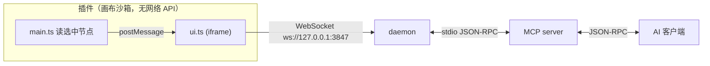
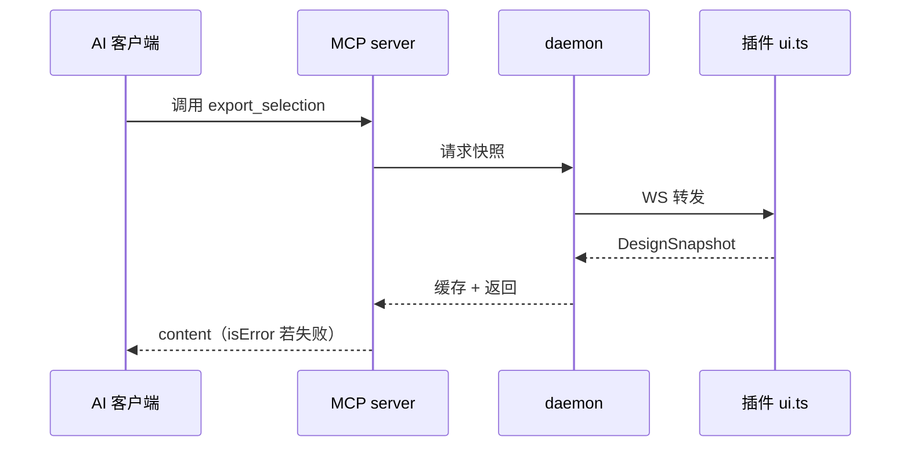

# 架构设计技能

## 职责边界（与兄弟技能分工）

| 技能 | 职责 | 时机 |
|---|---|---|
| **arch-design**（本技能） | 想清楚：需求 → 架构文档 + 图 | 写码前 |
| writing-plans | 拆步骤：架构定稿后出实施计划 | 设计定稿后 |
| task-tracker | 盯执行：进度/问题/恢复 | 实施期间 |
| bridge-dev | 写代码：桥接集成的编码规范 | 编码时 |

链路：arch-design → writing-plans → task-tracker（→ bridge-dev 编码）。

## 核心规则

### 1. 需求结构化（设计前置，三要素缺一不动手）

- **背景**：为什么做（什么痛点/替代什么流程）
- **目标**：可验证的终态（不是功能清单）
- **约束**：运行环境限制（沙箱/无网络/进程隔离）、依赖、不可协商项

模糊需求先向用户澄清，澄清结果回填三要素，不靠设计时脑补。

### 2. 文档落点

| 场景 | 落点 |
|---|---|
| 单个集成的架构 | `packages/<集成名>-bridge/docs/architecture.md` |
| 仓库级架构 | `docs/architecture.md` |
| 任务阶段的设计草稿 | 任务文档「方案设计」节，定稿后沉淀到上述位置 |

文档骨架：

```markdown
# <名称> 架构

## 1. 需求（背景/目标/约束）
## 2. 总体架构（组件图 + 文字说明）
## 3. 关键流程（时序图 + 文字说明）
## 4. 关键决策（每条：问题 / 候选 / 选择 / 理由）
## 5. 风险与未决项（标注 TODO(实测)）
```

### 3. 架构图规则（文字即源码）

- 图源码只存在于 md 内的 ```mermaid 代码块；**不维护独立图片文件，不提交渲染产物**
- **一图一用途**：组件结构用 `flowchart`，跨进程交互用 `sequenceDiagram`，状态流转用 `stateDiagram-v2`——不混在一张图里
- 每张图必须有紧邻的文字说明（图是视图，文字是主体，同文件才能不漂移）
- 方向约定：分层结构 `flowchart LR`（自左向右），流程流转 `flowchart TB`（自上而下）
- 未实测/未确认的路径用虚线 `-.->` 并标 `TODO(实测)`
- 选型依据：GitHub 原生渲染、零依赖、AI 生成准确率最高；不引入 PlantUML/D2（渲染依赖不值得）

## 示例（本仓三件套桥接，真实结构）





## 检查清单

设计前：
- [ ] 需求三要素齐全（背景/目标/约束），模糊处已向用户澄清
- [ ] 已确认落点（集成级 / 仓库级 / 任务草稿）

设计后：
- [ ] 每张图有紧邻文字说明；一图一用途
- [ ] 未实测路径虚线 + `TODO(实测)`
- [ ] 关键决策已记录（问题/候选/选择/理由）
- [ ] 无独立图片文件、无渲染产物入库
- [ ] 架构文档已落点，任务文档「相关文件」有引用

## 常见问题

- **为什么 mermaid 而不是 PlantUML？** GitHub 原生渲染零依赖；PlantUML C4 全套表达力更强，但需 Java/服务端渲染，个人仓库不值。
- **为什么不提交 PNG/SVG？** 图片不可 diff、不可审阅；mermaid 源码是文本，改动走 git review，渲染永远最新。
- **和 task-tracker「方案设计」什么关系？** 任务文档的方案节是讨论过程草稿（含被否方案）；architecture.md 是定稿沉淀（长期有效）。定稿后从草稿迁入。
- **图里的组件名从哪来？** 与文件职责表（docs/structure.md）一致——图反映结构，结构以职责表为准，两处不同步时先改职责表再改图。
