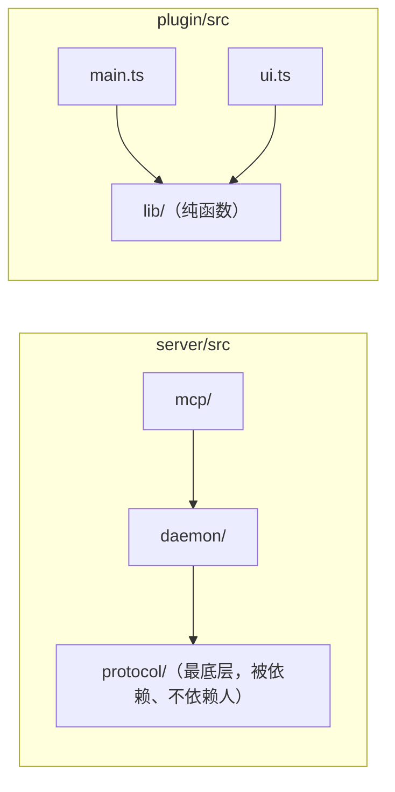

# 桥接集成开发规范

防止单文件膨胀是本规范的第一目标：智能体开发倾向"向已加载文件顺手追加"，必须用结构性约束打断这个路径。

## 架构与依赖方向（不可违反）


依赖只能沿箭头方向（箭头指向被依赖方），**禁止反向**：



- import 只能沿箭头方向，**禁止反向**：protocol 不 import daemon/mcp；lib 不 import main/ui
- 两端共享的消息 schema **只允许一处定义**：`server/src/protocol/` 是单一事实源。插件侧如需同构类型，手抄镜像到 `plugin/src/types.ts` 并注释指向 protocol 源文件，禁止第二处独立演化

## 目录骨架（新集成包照此搭建）

```
packages/<集成名>-bridge/
├── plugin/
│   ├── manifest.json          # 插件声明
│   ├── src/
│   │   ├── main.ts            # 沙箱主线程入口：只装配（读选中 → 调 lib → postMessage 转发）
│   │   ├── ui.ts              # iframe 侧：WebSocket 连 daemon、重连、面板状态
│   │   └── lib/               # 沙箱纯函数：序列化器等，可单测
│   ├── ui.html                # 面板壳，引 ui 打包产物
│   └── dist/                  # esbuild 产物（gitignore）：code.js、ui.js
├── server/
│   ├── src/
│   │   ├── index.ts           # 入口：只装配，不写逻辑
│   │   ├── daemon/            # WS 服务端、连接管理、数据缓存
│   │   ├── mcp/
│   │   │   ├── index.ts       # MCP server 装配、工具清单注册
│   │   │   └── tools/         # 一工具一文件：<tool-name>.ts
│   │   └── protocol/          # 消息 schema（单一事实源）
│   ├── package.json
│   └── tsconfig.json
└── docs/
    ├── api-notes.md           # 工具 API 人工沉淀（CLAUDE.md 已约定）
    └── structure.md           # 文件职责表（见下节制度）
```

## 文件职责表制度（structure.md）

- 每个集成包在 `docs/structure.md` 维护全部源码文件的职责登记：路径 + 一句话职责 + 状态（规划中/实现中/已验证）
- **新建文件必须先入表再写码**；拆分、删除、改职责同步更新表
- 判断"该不该往这个文件加代码"的依据是表里的职责描述，不是行数还够不够

## 防膨胀熔断线

| 指标 | 默认阈值 | 触发动作 |
|---|---|---|
| 单个源码文件 | 300 行 | 停止追加，向用户提出拆分方案（拆到哪、新建什么文件），确认后再动 |
| 单个函数 | 50 行 | 拆出纯函数移入 lib/ 或同层模块 |
| MCP 工具文件 | 同 300 行 | handler 与 schema 定义可分离 |

- 阈值是"**停下来讨论**"的触发器，不是硬凑行数达标
- 统计口径：`src/` 手写源码；`dist/` 产物、`node_modules/`、打包 bundle 不计
- 向已有文件追加前先看当前行数，预判超限就直接走拆分流程

## 技术栈与构建

- 语言统一 TypeScript
- 插件沙箱**无模块系统**：code.js 不能 import 其他文件，源码多文件必须经 esbuild 打包为单产物
- 沙箱主线程大概率无网络 API：WebSocket 建在 ui.html iframe 侧（ui.ts），main 与 ui 经 `jsDesign.ui.postMessage` 通信——jsdesign 兼容 Figma 的程度以控制台实测为准，未实测处标 `TODO(实测):`
- MCP server 用 `@modelcontextprotocol/sdk`，stdio 传输：`McpServer` from `.../server/mcp.js`，`StdioServerTransport` from `.../server/stdio.js`
- 工具用高层 API 注册：`server.tool(name, description, zodSchema, handler)`；参数 schema 用 zod 定义并 `.describe()` 描述（SDK 依赖 zod，官方惯例）
- WS 端口 / 空闲超时等协议常量集中定义在 protocol/（参考实现印证：ws://127.0.0.1:3847，全断开空闲 15 分钟 daemon 自退）
- 构建产物 `dist/` 不入库
- tsconfig 两侧均 `strict: true`

## TS 代码规范

### 领域概念（统一词汇，命名围绕它们展开）

| 概念 | 含义 | 定义处 |
|---|---|---|
| `PluginMessage` | 插件 → daemon 的 WS 消息，判别联合（`type: 'export' \| 'ping' \| ...`） | `server/src/protocol/messages.ts` |
| `DesignSnapshot` | 一次导出的节点树 + 设计 token + 元信息（exportedAt/source） | 同上 |
| `SnapshotCache` | daemon 持有的最新 DesignSnapshot，MCP 工具的读取源 | `server/src/daemon/cache.ts` |
| `ToolResult` | MCP 工具返回结构 `{ content: TextContent[], isError?: true }`（官方约定：工具错误在 result 内上报，非协议级错误） | `server/src/mcp/types.ts` |

新增领域概念先入本表再写码（与 structure.md 制度同理）。

### 类型设计

- 消息一律判别联合 + `type` 判别字段，switch 收窄；**禁止 `any`，禁止 `as unknown as`**
- 未实测的 jsDesign 字段声明 `unknown`，在 lib/ 写类型守卫收窄，并标 `TODO(实测):`
- 对象结构用 `interface`，联合/工具类型用 `type`
- 导出一律具名导出，禁 `export default`
- protocol 类型变更 = 消费方 breaking change：同步检查 ui-restore 引用与插件侧 types.ts 镜像

### 命名

- 文件 kebab-case（`export-selection.ts`）；类型 PascalCase；变量/函数 camelCase；常量 UPPER_SNAKE
- 布尔值 `is/has` 前缀；事件回调 `onXxx`；数据获取 `getXxx`
- WS 地址、超时、重连间隔等常量集中定义（protocol/ 或 config），禁止散落字面量

### 函数设计

- **jsDesign API 调用只出现在 main.ts**；lib/ 只接收已取到的普通对象做映射（同输入同输出，可单测）
- 副作用（网络/IO/状态）只允许出现在 daemon/、mcp/、main.ts、ui.ts 边界层
- 参数超过 3 个收拢为 options 对象
- 可预期失败（无选中、缓存空、插件未连接）返回 `undefined` 或判别联合，不抛异常；编程错误才 throw

### 错误处理与日志（stdio 关键坑）

- **server 侧日志一律 `console.error`（stderr）——stdio 模式下 stdout 被 JSON-RPC 协议占用，`console.log` 会污染协议流导致客户端断连**
- MCP 工具 handler 不向 SDK 抛异常：失败以 `isError: true` + `content`（错误文本含可操作指引，如"请先在画布选中节点"）返回——官方约定工具错误在 result 对象内上报而非协议级错误，LLM 才能看到并处理
- 工具数据结果 JSON.stringify 后放 `content: [{ type: "text", text }]`；超长导出（数十万字符级）先落盘临时文件，content 只返回 path + preview（参考实现实践，避免撑爆上下文）
- 结果可带 `hint` 字段给 AI 下一步指引（成功与失败皆可）
- 插件断连/未连接是正常状态不是异常：返回明确状态与重试指引

### 沙箱侧（plugin）补充约束

- DOM / WebSocket 只出现在 ui.ts 与 ui.html；`jsDesign.*` 只出现在 main.ts 与 lib/
- 运行时零 npm 依赖（esbuild 属 devDependencies）；打包体积敏感
- main ↔ ui 只经 `jsDesign.ui.postMessage`，消息结构镜像自 protocol 并注释指向源文件

### 测试

- lib/ 纯函数：`node:test` 单测（零额外依赖），与实现同目录 `*.test.ts`
- daemon / mcp：真实路径验证（真实客户端连 MCP），不写 mock 测试

## 检查清单

改动前：
- [ ] 已读集成 docs/structure.md（职责表）与 docs/api-notes.md
- [ ] 新文件已先入职责表；新领域概念已先入概念表
- [ ] 本次改动的依赖方向未反向

改动后：
- [ ] 无源码文件超熔断线
- [ ] 无 `any` / `as unknown as`；未实测字段走 `unknown` + 守卫 + `TODO(实测)`
- [ ] server 侧日志全部走 stderr（console.error）
- [ ] 入口文件仍是纯装配
- [ ] plugin 改动已重新构建（esbuild）
- [ ] 跑通真实执行路径验证（脚本实跑 / 真实客户端连 MCP），非仅类型检查

## 常见问题

- **为什么 code.js 不能 import？** 沙箱无模块系统（Figma 兼容体系），多文件只能构建期打包。
- **WebSocket 该写在哪？** ui.html iframe 侧（ui.ts）。骨架早期写在 main 侧的注释是待校正项，以阶段 1a 实测为准。
- **参考实现是 26.6KB 单文件，为什么不照抄？** 它是膨胀样本——协议设计可参考，文件组织不参考。
- **为什么职责表不放本技能里？** 技能承载通用规则，职责表是每个集成的实例数据，随代码演进频繁更新，放集成 docs 避免技能本体膨胀。
- **为什么 server 里不能用 console.log？** stdio 传输下 stdout 承载 JSON-RPC 协议帧，混入日志文本会破坏协议流；日志走 stderr。
